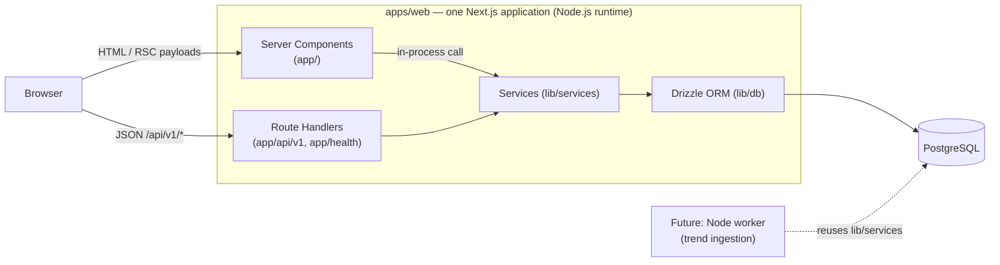

# MotoScope Architecture

> Status: living document. Last revised 2026-10-31, after migrating the backend from ASP.NET Core to Next.js
> Route Handlers (see [BACKEND_MIGRATION_AUDIT.md](BACKEND_MIGRATION_AUDIT.md)).

## 1. System overview



| Component | Responsibility | Hosting |
|---|---|---|
| `apps/web` | Server-rendered public site, SEO, and the REST API (`/api/v1/*`): domain logic, persistence, validation, authorization, audit log | Vercel or any Node.js host |
| PostgreSQL | System of record | Managed provider (Neon, Supabase, RDS, Azure). Use a **pooled** connection string on serverless |
| Future worker | Scheduled ingestion (Trend Radar) | Same repository, separate Node process or managed cron; reuses the same TypeScript services |

There is one deployable application and one database. There is no separate backend server, no Express/NestJS, and no microservices.

## 2. Code layout

```text
apps/web/src/
  app/                    Pages (Server Components by default) and Route Handlers
    api/v1/...            REST endpoints (thin: parse → service → JSON)
    health/{live,ready}   Health checks
  lib/
    domain/catalogue/     Enums, spec keys (shared vocabulary)
    db/                   Drizzle schema, client, migrations/, migrate.ts, seed/
    services/             Business logic (catalogue queries, admin CRUD, auth, audit)
    validation/           Zod schemas (query strings and JSON bodies)
    http/                 Route wrapper, Problem Details, errors, rate limiting
    auth/                 Password hashing, sessions, roles/policies, staff accounts
    data/                 Server Component data access (in-process calls to services)
    logging/              Structured JSON logger
    api/types.ts          API contract (DTO types) shared by routes and pages
  components/, lib/format.ts, lib/catalogue-query.ts …   UI
apps/web/scripts/         CLI: db-migrate, db-seed, create-admin (tsx)
apps/web/tests/           Integration tests (real PostgreSQL) and test support
apps/web/e2e/             Playwright flows
```

Rules:
- **Route Handlers are thin.** They validate input (Zod), call a service, and return a DTO. Business rules live in `lib/services`, never in handlers or React components.
- **No entities in responses.** Services project explicit DTO shapes (`lib/api/types.ts`); list and detail queries select only the columns they need.
- **Server Components call services in-process** through `lib/data/*`. There is no HTTP hop to our own API. Browser-facing interactions (admin UI, forms) use `/api/v1/*`.
- **Explicit composition instead of DI.** Services are plain modules. The request context (user, correlation id) is passed explicitly as an `Actor`.

## 3. Rendering and caching

- `cacheComponents` is **off**. Pages that read data call `connection()`, so they render at request time and `next build` never needs a database. Detail pages return real HTTP 404s. Routes that can 404 must not sit under a `loading.tsx` boundary (it would stream a 200 first). The catalogue skeleton lives in the `(catalogue)` route group for this reason.
- There is no cross-request data cache yet: queries are indexed and projected. When traffic warrants it, add `unstable_cache`/tag-based caching per read model with explicit invalidation on admin writes.
- Filtering is server-backed. The catalogue filter form is a plain GET form whose fields become shareable URL parameters.

## 4. API cross-cutting concerns (`lib/http/route.ts`)

Every Route Handler is wrapped by `route(options, handler)`, which provides:
- **Correlation id.** Accepts a well-formed `X-Correlation-ID` or derives one from a W3C-style trace id, echoes it on the response, and adds it to logs and audit rows.
- **Rate limiting.** Fixed windows per client and policy (`public-read`, `auth`, `submission`). In-memory per instance; client IP from `X-Forwarded-For` only when `TRUST_PROXY=true`.
- **CSRF defence.** Unsafe methods with a foreign `Origin` get 403; JSON bodies are required (415 otherwise). Together with `SameSite=Strict` cookies, this blocks cross-site writes.
- **Authentication and authorization.** `policy: "RequireEditor" | "RequireModerator" | "RequireAdmin"` or `authenticated: true`. 401 when signed out, 403 for the wrong role. The check runs on every protected route on the server.
- **Errors.** Typed errors map to RFC 9457 Problem Details (`traceId`, `correlationId`). Unknown errors return a 500 with no details and are logged with stack traces server-side. PostgreSQL unique violations map to 409.
- **Logging.** One structured JSON line per request: method, path (no query string), status, duration, correlation id.

## 5. Authentication and authorization — decision

The application is the single identity authority; there is no Auth.js. Staff-only login doesn't need OAuth providers, and keeping sessions in our own database lets them be revoked server-side.

1. Staff users live in the `users`/`roles`/`user_roles` tables (column layout inherited from ASP.NET Core Identity, so accounts created by the former backend keep working).
2. Passwords use the Identity **V3 hash format** (PBKDF2). New hashes use HMAC-SHA512 with 210,000 iterations. Existing hashes at any iteration count still verify.
3. Login (`POST /api/v1/auth/login`) checks lockout (5 failures → 15 minutes), creates a row in `sessions` (storing only the SHA-256 of a random 256-bit token) and sets cookie `motoscope.auth`: HttpOnly, `SameSite=Strict`, `Secure` in production, session-scoped. Sessions expire after 8 hours of inactivity (sliding). Logout deletes the row.
4. Every request to a protected route re-reads the session and the user's roles and active flag from the database, so deactivation and role changes take effect immediately.
5. **First admin:** `npm run admin:create -- --email you@example.com`. There is no default password and no public registration.

## 6. Data and keys

- PostgreSQL with **Drizzle ORM**. Schema in `lib/db/schema.ts`; migrations in `lib/db/migrations` (generated by drizzle-kit, reviewed, applied by `npm run db:migrate`). See [DATABASE.md](DATABASE.md) and [DATABASE_MIGRATION.md](DATABASE_MIGRATION.md).
- Keys are UUIDv7, generated in the application. Timestamps are `timestamptz` in UTC. Soft deletion uses `deleted_at`. Optimistic concurrency uses PostgreSQL `xmin` as `version`.
- Connection pooling: one `pg.Pool` per server process (`DATABASE_POOL_MAX`, default 10). On serverless, point `DATABASE_URL` at a pooler and keep the pool small.

## 7. Data integrity principles

Unknown specifications are absent, never guessed. Every value carries a provenance and an optional citation. Prices always carry their type, market, region and effective date. Demo records are flagged and badged everywhere.

## 8. Background processing (Trend Radar, later phase)

Route Handlers are request/response only and are not used as workers. Ingestion will run as a separate Node process (`apps/web/scripts/worker.mts`, or a managed cron calling a protected endpoint) that reuses `lib/services`. Provider adapters will be enabled only when their credentials are present. Each run is recorded in `ingestion_runs` with an idempotency key; an advisory lock prevents concurrent runs; failures are isolated per provider.

## 9. Images

`ImageStorage` abstraction (local disk in development, Cloudinary when configured). It is not implemented yet: no image uploads exist.

## 10. Key trade-offs

| Decision | Alternative | Why |
|---|---|---|
| Backend inside Next.js | Separate ASP.NET API (previous design) | One language and one deployment; shared types; no HTTP hop for pages. Background jobs move to a separate worker when needed |
| Drizzle | Prisma | SQL-first, explicit queries, small runtime; easy to adopt an existing schema byte-for-byte |
| Own sessions table | Auth.js / JWT | Staff-only login; server-side revocation; keeps existing Identity password hashes |
| EAV specifications with typed values | Wide variant table | Spec sets differ by powertrain and every value needs provenance |
| No Cache Components | Cache Components | Build independent of the database; correct 404 semantics |
