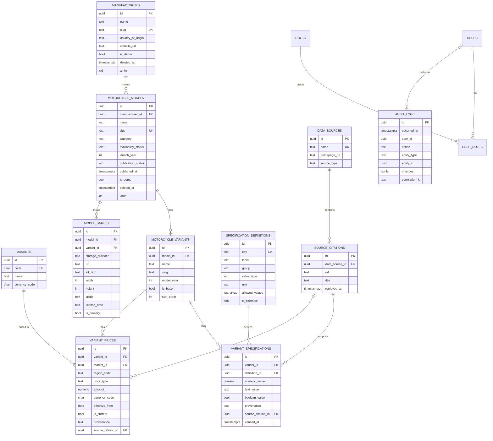

# Database

PostgreSQL 17 (any supported PostgreSQL ≥ 15 works; partial unique indexes use `NULLS NOT DISTINCT`, which needs 15+).
Schema is owned by Drizzle: `apps/web/src/lib/db/schema.ts` and migrations in `apps/web/src/lib/db/migrations` (the baseline is identical to the former EF Core schema; see [DATABASE_MIGRATION.md](DATABASE_MIGRATION.md)).

## Conventions

| Topic | Decision |
|---|---|
| Keys | UUIDv7 generated in the application (`Guid.CreateVersion7()`): time-ordered, non-guessable, mergeable across environments |
| Naming | `snake_case` tables and columns |
| Time | `timestamptz`, always UTC. `created_at`/`updated_at` are set by the services on every write |
| Enums | Stored as readable strings (`varchar(32)`), so reordering enum members can never corrupt data |
| Soft delete | `deleted_at` on manufacturers, models and variants; every public query filters `deleted_at IS NULL`. Slugs stay reserved after archival |
| Concurrency | PostgreSQL `xmin` mapped as a row version on manufacturers and models. Admin `PUT` must send `version`, and a stale version returns 409 |
| JSONB | Used only for `audit_logs.changes` (field diffs whose shape varies by entity) |
| Unknown values | Absence of a row, never a placeholder value |

## Entity relationship diagram (implemented)



Staff tables (`users`, `roles`, `user_roles`) keep the column layout of the former ASP.NET Core Identity store, so existing accounts and password hashes keep working. `sessions` (added by migration 0001) stores SHA-256 hashes of session tokens with an expiry. The legacy Identity tables `user_claims`, `user_logins`, `user_tokens` and `role_claims` are unused.

## Entity notes

- **Specifications (EAV with typed values).** `specification_definitions` describes each attribute: key, label, group, canonical unit and value type. `variant_specifications` holds one value per variant and definition. A check constraint enforces exactly one of `numeric_value`/`text_value`/`boolean_value`. Every value carries `provenance` (`ManufacturerClaimed`, `EditoriallyVerified`, `OwnerReported`, `Estimated`, `Demo`) and an optional citation. EAV was chosen over a wide table because spec sets differ by powertrain (ICE vs EV) and each value needs its own provenance. Canonical units: cc, kW, Nm, rpm, mm, kg, L, km/l, km, kWh, h.
- **Prices.** One row per (variant, market, region, type, effective date). `is_current` marks the latest. A partial unique index guarantees at most one current price per (variant, market, region, type). `region_code = NULL` means market-wide. `price_type` (`ExShowroom`, `OnRoad`, `Estimated`, `Illustrative`) is always displayed.
- **Publication.** Only `publication_status = 'Published'` and non-archived models are visible publicly.
- **Audit log.** Append-only and written in the same transaction as the change it describes.

## Index strategy

| Index | Serves |
|---|---|
| `motorcycle_models(slug)` unique, `manufacturers(slug)` unique | Detail page lookups |
| `motorcycle_models USING gin (name gin_trgm_ops)` | `ILIKE '%term%'` search (`pg_trgm` extension) |
| `motorcycle_models(publication_status, category)` | Default catalogue filter |
| `motorcycle_models(updated_at)` | "Recently updated" sort |
| `variant_specifications(definition_id, numeric_value)` | Range filters (cc, seat height, weight) and engine sort |
| `variant_specifications(definition_id, text_value)` | Enum filters (fuel, transmission, ABS) |
| `variant_specifications(variant_id, definition_id)` unique | One value per variant per spec |
| `variant_prices(market_id, is_current, amount)` | Price filter and sort |
| `variant_prices(variant_id, market_id, region_code, price_type) WHERE is_current` unique, nulls not distinct | Integrity of "current price" |
| `audit_logs(entity_type, entity_id)`, `audit_logs(occurred_at)` | Audit history per record, recent activity |

Catalogue queries load a page of model ids first, then card data in four fixed queries (models, card specs, current prices, images). There are no N+1 queries.

Note: spec and price filters match when any variant of a model satisfies each filter independently. With two filters, the matches can come from different variants. This is acceptable for discovery. Comparison works at variant level.

## Planned entities (later phases)

Trends: `trend_categories`, `trend_topics`, `trend_topic_models`, `trend_sources`, `trend_observations`, `ingestion_runs`. Reliability: `reliability_issues`, `reliability_issue_evidence`, `owner_reports`, `moderation_actions`, `issue_status_history`. Editorial/growth: `articles`, `article_categories`, `newsletter_subscribers` (only with a real double opt-in), `affiliate_placements` (inactive until real partnerships exist).

## Migrations and seed

```bash
cd apps/web
# after changing src/lib/db/schema.ts: generate a migration and READ the SQL before committing it
npm run db:generate
# apply migrations + idempotent reference data (markets, roles, spec definitions) — all environments
npm run db:migrate
# development only: demo catalogue (fictional brands); --reset rebuilds only demo rows
npm run db:seed -- --reset
```

The demo seed refuses to run when `NODE_ENV=production` or `MOTOSCOPE_ENV=production`. It touches only rows flagged `is_demo` and the demo data source.
